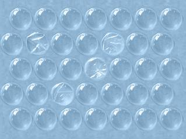

# Chpocker

Чпокер - пупырчатый релаксант. 

Всем знакомо это лечебно-расслабляющее средство - плёнка с воздушными пуырышками для успокоения нервов. Оно помогает избавиться от стресса за день, переключить мысли, рестартнуть мозг и настроиться на созидание. 

Веб-приложение чпокер даёт вам возможность похлопать этой плёнкой когда под рукой нет ничего кроме браузера или Телеграмма.

# Changelog

За время существования этого приложения было найдено как минимум две версии - со звуком и без, которые позже были дописаны и доделаны. К сожалению вариантов до переделок уже не найти.

- **v1** Похоже что самый ранний чпокер, созданный в 2000х мною почти случайно, почти не переделывался.

- **v2** Версия со звуком.

- **v3** Избавляемся от Jquery. Игра переписана на common-js

- **v4** Переходим на Canvas. Эта версия будет развиваться дальше, остальные останутся для истории в папке `history`.

# Планы

Здесь будем собирать самое важное чтобы потихоньку реализовывать

1. ~~Возможность собственно делать то для чего чпокер создан - чпокать.~~
2. ~~Мультихлоп мультитачем~~
3. Скролл экрана во все строны
4. ~~Включать-выключать звук~~
5. Менять цветовую палитру
6. Серверная часть и многопользовательская игра

# Улучшения

## Функциональные улучшения
1. ~~**Мультитач поддержка** - возможность лопать несколько пузырьков одновременно на сенсорных устройствах~~
2. **Бесконечный скролл** - возможность скроллить поле во все стороны для бесконечного чпоканья
3. ~~**Настройки звука** - добавить регулятор громкости и возможность включать/выключать звук~~
4. **Цветовые темы** - добавить возможность выбора различных цветовых схем (светлая, темная, цветная)
5. ~~**Статистика** - счетчик лопнутых пузырьков и время, проведенное в приложении~~
6. **Режим соревнования** - кто быстрее лопнет определенное количество пузырьков
7. **Анимация лопания** - более плавная и реалистичная анимация при лопании пузырьков
8. **Разные размеры пузырьков** - возможность выбора размера пузырьков (мелкие, средние, крупные)

## Технические улучшения
1. **Оптимизация производительности** - улучшение работы на слабых устройствах
2. **Сохранение состояния** - запоминание состояния поля между сессиями
3. **Прогрессивное веб-приложение (PWA)** - возможность установки на домашний экран и работы офлайн
4. **Адаптивный дизайн** - лучшая поддержка различных размеров экрана
5. **Предзагрузка ресурсов** - оптимизация загрузки изображений и звуков
6. **Кэширование** - использование Service Worker для кэширования ресурсов

## Интеграции
1. **Интеграция с Telegram** - использование Telegram Web App API для лучшей интеграции
2. **Многопользовательский режим** - возможность чпокать вместе с друзьями
3. **Таблица лидеров** - сохранение рекордов и отображение лучших результатов
4. **Шаринг в соцсети** - возможность поделиться своими достижениями

## Улучшения доступности
1. **Поддержка клавиатуры** - возможность управления с клавиатуры
2. **Высокий контраст** - специальный режим для людей с нарушениями зрения
3. **Звуковые подсказки** - дополнительная звуковая обратная связь
